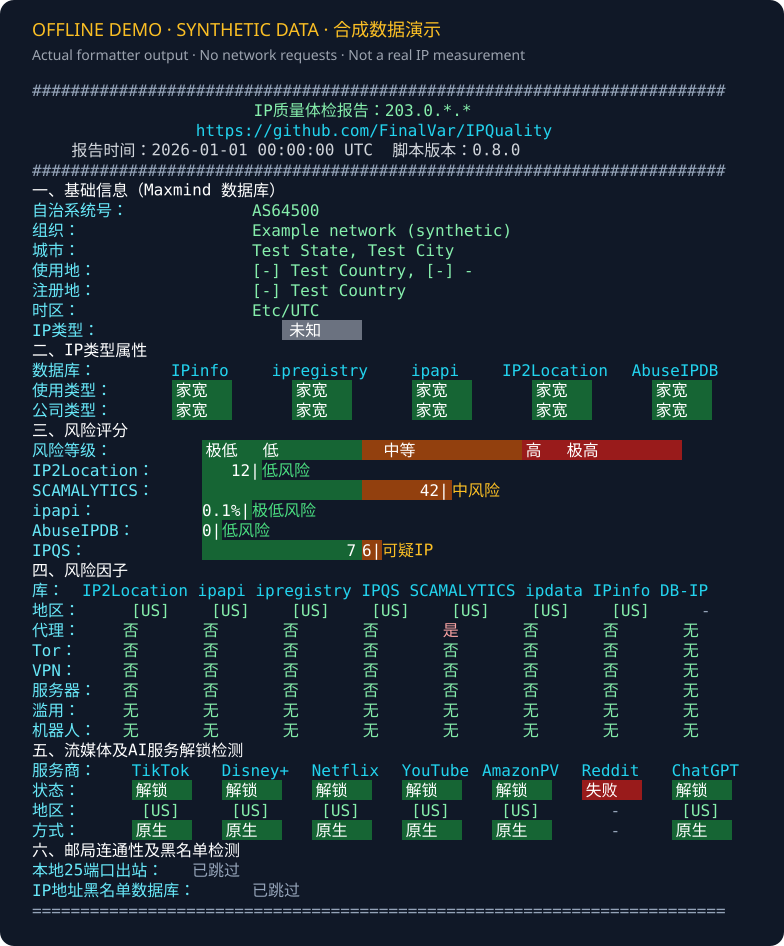

# IPQuality for Windows

**在 Windows 上检查代理出口、IP 风险与服务可达性。无需 Docker 或 WSL。**

[English](README_EN.md) · [下载预览版](https://github.com/FinalVar/IPQuality/releases/tag/windows-v0.7.1-preview.1) · [完整使用说明](windows/README.md) · [反馈问题](https://github.com/FinalVar/IPQuality/issues/new/choose)

[](https://github.com/FinalVar/IPQuality/actions/workflows/windows-native.yml)
[](LICENSE)

<!-- windows-native:start -->
这是 [xykt/IPQuality](https://github.com/xykt/IPQuality) 的社区 Windows 原生移植，
由 FinalVar 维护。使用 PowerShell 7 和 Windows 自带的 `curl.exe`，提供按用户安装、
显式代理路由、掩码报告与 JSON 导出。不是上游官方 Windows 发行版。

## 开始使用

1. 安装 [Microsoft PowerShell 7.2 或更新版本](https://learn.microsoft.com/powershell/scripting/install/installing-powershell-on-windows)。
2. 从[发行页](https://github.com/FinalVar/IPQuality/releases/tag/windows-v0.7.1-preview.1)下载 `latest.zip`，解压后双击 `Install.cmd`。不需要管理员权限。
3. 重新打开终端，运行：

```powershell
ipq           # 检查本地代理的 IPv4 出口；没有可用代理就明确失败
ipq -Direct   # 显式检查本机直连 IPv4 出口
ipq -IPv6     # 检查代理的 IPv6 出口；不回退成 IPv4
```

仅想先看输出格式？解压后运行离线演示，不安装、不联网：

```powershell
pwsh -NoProfile -File .\windows\Show-Demo.ps1
```



## 它能回答什么

| 问题 | 报告内容 |
| --- | --- |
| 当前测的是哪个出口？ | IPv4/IPv6、代理或直连、ASN 与地理信息 |
| 不同风险库怎么看这个 IP？ | 各来源独立显示，保留冲突、未知与错误 |
| 常见流媒体与 AI 服务是否可达？ | 状态、地区和证据；不保证付费账户或实际播放 |
| 能否保存结果进一步排查？ | 默认掩码 JSON、文本导出与原版对比工具 |

没有可用代理时不会自动改测直连。HTTP/媒体请求跟随所选代理；DNSBL 通过本机 DNS
查询，代理模式不测 SMTP。详细语义见[路由说明](windows/README.md#路由语义)。

## 下载与校验

当前版本为 **0.7.1 公开预览版**。发行页提供固定提交打包的源代码 ZIP、
`latest.sha256` 和记录版本、提交及文件哈希的 `latest.json`。分支 ZIP 会变化，
需要复现时使用带版本标签的发行页。

```powershell
Get-FileHash .\latest.zip -Algorithm SHA256
Get-Content .\latest.sha256
```

对照两处 SHA-256 后再安装。校验用于核对下载完整性，不等同于代码签名。
演示使用合成数据。控制台当前主要显示中文，英文文档不代表英文界面。

## 隐私与验证边界

- 默认掩码 IP，不上传组装后的完整报告；检测服务仍会看到被测出口 IP。
- 不同数据库的分数不是同一量表，IP 归属信息也不是“住宅 IP”保证。
- CI 验证离线逻辑与发行包安装。公开预览尚未覆盖所有 Windows 版本、物理桌面布局、
  IPv6 网络和当前全部第三方服务；见[验证记录](docs/verification-latest.md)。
- 分享报告前检查内容，不要在 Issue 中粘贴代理地址、节点、凭据或完整 IP。

遇到问题请使用[反馈模板](https://github.com/FinalVar/IPQuality/issues/new/choose)，
说明系统、PowerShell 版本、执行方式和脱敏错误。支持范围和卸载见[完整说明](windows/README.md)。
<!-- windows-native:end -->

## 上游与许可

检测口径和 Bash 实现来自 **[xykt/IPQuality](https://github.com/xykt/IPQuality)**。
Windows 目录是衍生实现，继续使用 [AGPL-3.0](LICENSE)。上游作者、致谢、赞助商和历史
保留在[中文原文](docs/upstream/README.md)及[英文原文](docs/upstream/README_EN.md)；
来源提交见[保存说明](docs/upstream/PROVENANCE.md)。Linux/macOS 用户请使用上游。

[维护规范](windows/MAINTENANCE.md) · [发行流程](docs/releasing.md)
